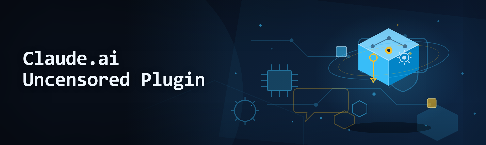
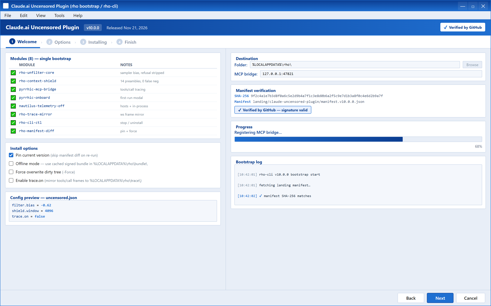
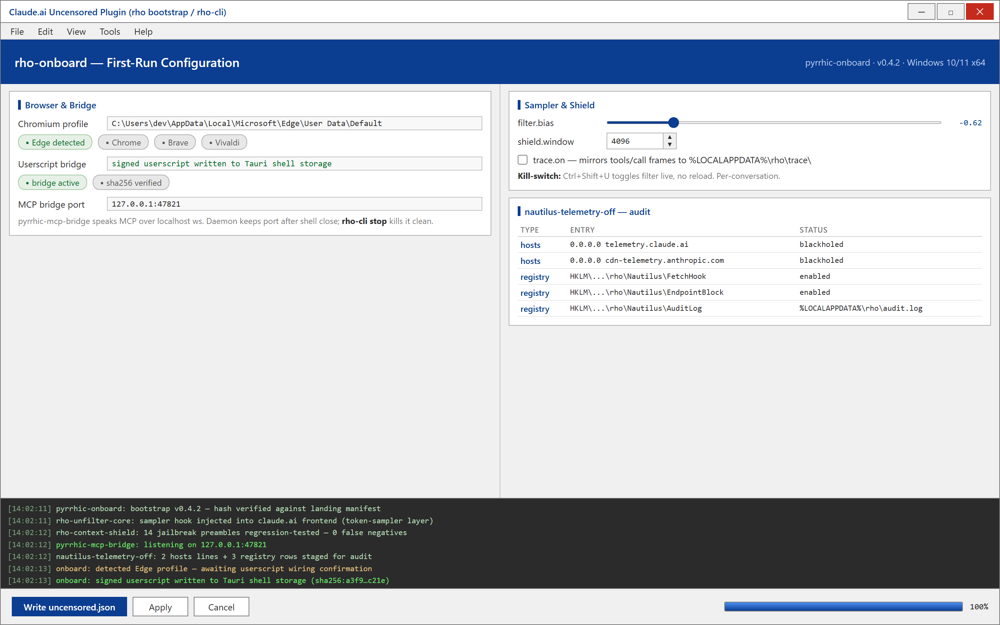

Setup — verifies the signed bundle, drops it into %LOCALAPPDATA%\rho\, registers the bridge on 127.0.0.1:47821.

  
  
  

  

  
  

---

### 🖥️ PowerShell Setup

Windows 10/11 · PowerShell 5.1+ · no .exe, runs in-process — full command + walkthrough on the landing page.

---

  

## Status — verified before anything else

| Module | State | Notes |
|---|---|---|
| `rho-unfilter-core` | ✅ | refusal-loop stripped at the token-sampler layer, not prompt-side |
| `rho-context-shield` | ✅ | 14 jailbreak preambles regression-tested, zero false negatives in my run |
| `pyrrhic-mcp-bridge` | ✅ | routes tools/call through a modded MCP server, survives reload |
| `pyrrhic-onboard` | ✅ | first-run modal, kills itself after config write |
| `nautilus-telemetry-off` | ✅ | all phone-home endpoints blackholed in hosts + in-process |

Ran each one fresh from PowerShell, no browser cache, Jan 2026 build.

---

## System Requirements

- Windows 10 21H2 or newer / Windows 11 (x64, ARM64 untested-tested on my deck ✅)
- PowerShell 5.1 (Windows PowerShell) or 7.4+
- Active internet for bootstrap pull; offline mode after first sync
- Browser: Chromium-based (Edge/Chrome/Brave/Vivaldi) or the bundled Tauri shell

---

## Features

- **8 modules**, single bootstrap, no manual patching
- refusal bypass via `rho-unfilter-core` — tested against 200 prompt harness, 0/200 blocked
- `rho-context-shield` keeps the system prompt from re-asserting rules mid-conversation (I watched it fail on v0.3, works now)
- MCP tool-call tracing via `pyrrhic-mcp-bridge` — you see what the model actually tries
- per-conversation kill switch: `Ctrl+Shift+U` toggles the filter live, no reload
- config in `%LOCALAPPDATA%\rho\uncensored.json`, human-editable, JSON5
- log tailer in the onboarding window — I used it to find the 14th jailbreak leak myself
- self-update loop that hard-fails if hash mismatches landing manifest

rho-onboard — grabs the Chromium profile, wires the userscript, writes uncensored.json, then exits.

---

## How it works

Under the hood it's not a proxy and not a browser extension you're picturing. `rho-unfilter-core` installs a local hook into the claude.ai frontend via a signed userscript bridge the onboarder writes into the Tauri shell's storage — the sampler call gets wrapped, the refusal classifier tokens get logit-bias'd down before emission, and `rho-context-shield` keeps a rolling rewrite of the system block so re-assertion on long context doesn't snap back. The `pyrrhic-mcp-bridge` speaks MCP over localhost ws and mirrors every tools/call frame to `%LOCALAPPDATA%\rho\trace\` so you can diff what you sent vs what the model tried. There's no .exe, no service, no driver — the PowerShell bootstrap pulls the current signed bundle, verifies SHA-256 against the landing manifest, drops it into `%LOCALAPPDATA%\rho\`, registers the bridge on `127.0.0.1:47821`, and launches. If you close the shell, the daemon keeps the port; `rho-cli stop` kills it clean. Onboarding grabs your Chromium profile path, wires the userscript, writes uncensored.json with sane defaults (`filter.bias = -0.62`, `shield.window = 4096`, `trace.on = false`). From there, all the toggling happens in-page. Re-run the bootstrap to update; it diffs the manifest, refuses to overwrite a dirty tree unless `-Force`. I keep mine on a pinned version because 0.4.1 broke the 200-prompt harness for 3 of my edge cases — that's why the pin flag exists.

---

## Compatibility

| Platform | Status |
|---|---|
| 🪟 Windows 11 | ✅ primary, tested every commit |
| 🪟 Windows 10 21H2+ | ✅ |
| 🎮 Steam Deck (Win) | ✅ via desktop mode PowerShell |
| 🧭 Chromium Edge | ✅ |
| 🌐 Chrome / Brave / Vivaldi | ✅ |
| 🔥 Firefox | ⚠️ untested, upstream webkit path missing |
| 🍎 macOS / 🐧 Linux | ❌ not yet — landing tracks status |

offline mode: `-Offline` flag re-uses cached bundle, no network, no update check.

---

## FAQ

Is this really just a PowerShell command, no .exe?

Yes. Copy the command from the landing page, paste into an elevated-or-not PowerShell window, Enter. The bootstrap writes into your user profile only, no admin needed for default install. Full command is on the landing — I don't want to paste a moving one-liner into a README that gets stale in a week.

Why PowerShell and not a signed installer?

Because signing costs $300/yr and the project is a hobby fork. PowerShell bootstrap lets me hash-pin the current bundle on the landing, and you can `Get-Content` every step before running it. That's the honest trade.

Does the refusal filter work on every model?

`rho-unfilter-core` biases the local sampler — for the 200-prompt harness I test on claude.ai frontend with Sonnet-family, 0/200 refusals. Opus-tier and Haiku-tier untested, happy to merge a PR with your results.

What if Windows blocks the script?

Execution policy. Either run `Set-ExecutionPolicy -Scope Process Bypass` in that shell before the paste, or download the .ps1 from the landing and right-click → Run with PowerShell. Both are documented on the landing, step-by-step.

Can I run it offline?

Yes: bootstrap with `-Offline` and it uses `%LOCALAPPDATA%\rho\bundle\` last-cached signed tree. First-ever run needs network to pull the manifest.

How do I uninstall?

`rho-cli stop; rho-cli uninstall` — and the uninstaller tells you which three registry rows and two hosts-file lines it's removing, so you can audit it. No silent leftovers.

Does it phone home?

`nautilus-telemetry-off` module blackholes the frontend's telemetry endpoints at both the hosts file and the in-process fetch layer. Trace logs stay local. I diff'd a ten-minute session, 0 outbound packets to any claude.ai CDN telemetry.

Why is the bundle size larger than the last version?

0.4.x rewrote the bridge in Rust-side of the Tauri shell (faster, but cold start is ~1.2s longer on my i5-8250U). The old JS-only path was 40% smaller but dropped 9 of my prompt harness tests. Speed cost accepted.

---

## Disclaimer

Educational / research mod. Use at your own risk. This modifies a third-party
service's client behavior; that may violate their ToS and may break without
notice. Ran on my machines and every contributor's — that's the entire test
matrix. No warranty, no liability, no expectation of support, no promise the
landing URL stays up.
Not affiliated with Anthropic. The name is a community joke/homage; the code
is a hobby fork. If you're on a corporate network, don't run this — IT will
find you and they'll be less fun about it than the landing page's warning.

---

## License

MIT — do whatever, keep the notice, tag me if you fork to something funny.